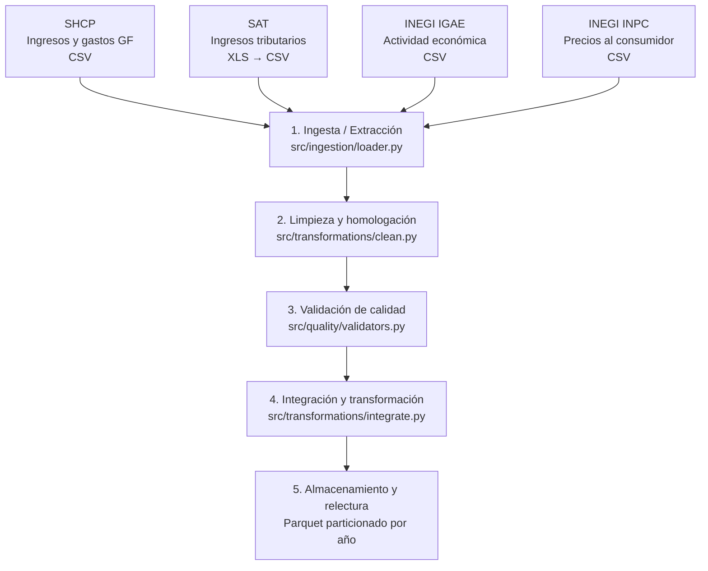

# Proyecto Integrador — Pipeline Modular en PySpark (Actividad 11)

Pipeline de procesamiento de datos macroeconómicos y fiscales de México desarrollado en **PySpark** bajo una arquitectura modular reproducible. Integra series mensuales de gasto público (**SHCP**), recaudación tributaria (**SAT**), actividad económica (**INEGI - IGAE**) e inflación (**INEGI - INPC**) para el periodo **enero de 2015 a marzo de 2025** (123 meses).

---

## Arquitectura del flujo de datos



---

## Estructura del repositorio

```text
Integrador-PGBD-26A/
├── data/
│   ├── raw/                          # Fuentes crudas descargadas (ignorado en Git)
│   └── processed/                    # Dataset maestro en Parquet particionado por año (ignorado en Git)
├── docs/                             # Documentación de fuentes y diseño del proyecto
├── notebooks/
│   └── 01_ingesta.ipynb              # Descarga automatizada, descompresión y conversión SAT XLS → CSV
├── reports/
│   └── evidencia_ejecucion_act11.txt   # Registro de conteos, validaciones y métricas de ejecución
├── src/
│   ├── __init__.py
│   ├── pipeline.py                   # Orquestador ejecutable de principio a fin
│   ├── ingestion/
│   │   ├── __init__.py
│   │   └── loader.py                 # Sesión de Spark, validación de rutas y esquemas explícitos
│   ├── quality/
│   │   ├── __init__.py
│   │   └── validators.py             # Controles de nulos, duplicados por llave y continuidad temporal
│   └── transformations/
│       ├── __init__.py
│       ├── clean.py                  # Llave común `fecha`, deduplicación SHCP y homologación monetaria
│       └── integrate.py              # Pivot SHCP, joins broadcast, ventanas YoY y escritura Parquet
├── .gitignore
├── requirements.txt
└── README.md
```

---

## Fuentes de datos y ventana de estudio

Todas las fuentes se homologan a una granularidad mensual común (`1 fila = 1 mes`) dentro de la ventana **2015-01-01 a 2025-03-01** (acotada al último dato disponible en la serie abierta del IGAE).

| Fuente | Institución | Archivo en `data/raw/` | Filas crudas | Filas limpias (ventana) | Unidad / Escala final |
| :--- | :--- | :--- | :---: | :---: | :--- |
| **Gasto Presupuestario (`XBC*`)** | SHCP | `ingreso_gasto_finan.csv` | 746,676 | 3,567 *(29 claves × 123 meses)* | Millones de pesos corrientes |
| **Ingresos Tributarios** | SAT | `ingresos_tributarios_sat.csv` | 201 | 123 | Millones de pesos corrientes |
| **IGAE (Serie Total)** | INEGI | `igae_mensual_csv/.../conjunto_de_datos_igae_*.csv` | 120 | 123 | Índice de volumen físico (Base 2018 = 100) |
| **INPC (Índice General)** | INEGI | `inpc_mensual_csv/.../conjunto_de_datos_inpc_mensual.csv` | 2,002 | 123 | Índice de precios (Base 2Q jul 2018 = 100) |

---

## Operaciones PySpark por etapa

| Etapa | Módulo | Operaciones PySpark | Decisiones técnicas |
| :--- | :--- | :--- | :--- |
| **1. Ingesta / Extracción** | `notebooks/01_ingesta.ipynb`<br>`src/ingestion/loader.py` | `SparkSession.builder`, `spark.read.csv(header=True, schema=...)` | El archivo `.xls` del SAT se convierte previamente a CSV en el notebook mediante `pandas` + `xlrd`. Se definen esquemas explícitos (`StructType`) para SHCP e INPC con el fin de evitar doble lectura y errores de inferencia. Se asigna `sys.executable` a `PYSPARK_PYTHON` para compatibilidad en Windows. |
| **2. Limpieza y homologación** | `src/transformations/clean.py` | `to_date`, `trunc`, `create_map`, `regexp_extract`, `regexp_replace`, `filter`, `stack`, `dropna`, `dropDuplicates` | Se construye la llave común `fecha` (primer día de cada mes, tipo `date`). En **SHCP** se filtran claves `XBC*` mensuales en pesos, se eliminan **2,523 registros exactamente duplicados** publicados desde 2018 y se divide entre `1,000` para convertir de miles a millones de pesos. En **SAT** se limpian saltos de línea en encabezados y marcas preliminares (`*`). En **IGAE** se aplica `F.stack` para pasar de formato ancho a largo. |
| **3. Validación de calidad** | `src/quality/validators.py` | `count`, `filter(col.isNull())`, `agg(min, max)`, `groupBy(llave).count().filter(count > 1)` | Verifica conteos positivos en la extracción, ausencia total de nulos en llaves y métricas, cero duplicados por `(fecha, CLAVE_DE_CONCEPTO)` en SHCP y continuidad exacta de **123 meses únicos** por fuente antes de integrar. |
| **4. Integración y transformación** | `src/transformations/integrate.py` | `groupBy("fecha").pivot("CLAVE_DE_CONCEPTO")`, `join(broadcast(...), on="fecha", how="inner")`, `Window.orderBy("fecha")`, `lag(..., 12)` | Se pivotean las 29 claves presupuestarias de SHCP y se unen las 4 fuentes mediante `broadcast()` para evitar *shuffle* innecesario. Se calculan cifras reales deflactadas con INPC, ratios fiscales y variaciones porcentuales interanuales (`YoY`) para neutralizar la estacionalidad mensual. |
| **5. Almacenamiento y verificación** | `src/transformations/integrate.py` | `write.mode("overwrite").partitionBy("anio").parquet(...)`, `spark.read.parquet(...)` | Persiste el dataset maestro en formato columnar Parquet particionado por año (`anio`) y ejecuta una relectura inmediata para validar que el conteo de filas (123) y el esquema (43 columnas) coincidan exactamente. |

---

## Variables principales del dataset maestro

El archivo de salida (`data/processed/dataset_maestro.parquet`) contiene **123 filas × 43 columnas**:

* **Llave y partición:** `fecha` (`date`), `anio` (`int`).
* **Gasto del Gobierno Federal (`SHCP`, millones de pesos):** `shcp_xbc` (Gasto Total del Gobierno Federal) y sus 28 desgloses programables, no programables, corrientes, de capital y costo financiero (`shcp_xbc10` a `shcp_xbc23`).
* **Recaudación Tributaria (`SAT`, millones de pesos):** `sat_total_tributarios`, `sat_isr`, `sat_iva`, `sat_ieps`.
* **Indicadores Macroeconómicos (`INEGI`):** `igae_total`, `inpc`.
* **Variables Analíticas Derivadas:**
  * `sat_total_real`: recaudación tributaria total deflactada con el INPC (`sat_total_tributarios / (inpc / 100)`).
  * `ratio_tributario_gasto`: proporción del gasto total del Gobierno Federal cubierta con ingresos tributarios (`sat_total_tributarios / shcp_xbc`).
  * `ratio_isr_tributario`: participación del ISR dentro del total de ingresos tributarios (`sat_isr / sat_total_tributarios`).
  * `igae_var_anual_pct`, `inflacion_anual_pct`, `sat_real_var_anual_pct`: variaciones porcentuales anuales (`lag` de 12 meses; `NULL` en 2015 al corresponder al primer año de la ventana).

---

## Instrucciones de ejecución

### 1. Instalar dependencias
Desde la raíz del repositorio:

```bash
pip install -r requirements.txt
```

### 2. Obtener las fuentes crudas (`data/raw/`)
Abrir y ejecutar todas las celdas de `notebooks/01_ingesta.ipynb` para descargar las cuatro fuentes oficiales, descomprimir los archivos ZIP de INEGI y convertir el archivo `.xls` del SAT a CSV.

### 3. Ejecutar el pipeline modular completo
Desde la raíz del repositorio (`Integrador-PGBD-26A/`):

```bash
python -m src.pipeline
```

> **Nota en Windows con Anaconda:** si `python` no está registrado en el `PATH` global de la terminal, ejecutar especificando la ruta del intérprete del entorno, por ejemplo:
> ```powershell
> & "C:\Users\<usuario>\anaconda3\python.exe" -m src.pipeline
> ```

---

## Evidencia de ejecución (Actividad 11)

El registro completo generado automáticamente por el pipeline se encuentra en [`reports/evidencia_ejecucion_act11.txt`](reports/evidencia_ejecucion_act11.txt).

* **Extracción cruda:**
  * `shcp`: 746,676 filas leídas
  * `sat`: 201 filas leídas
  * `igae`: 120 filas leídas
  * `inpc`: 2,002 filas leídas
* **Validación de calidad en ventana (`2015-01-01` a `2025-03-01`):**
  * `shcp`: 3,567 filas | 123 meses únicos | 0 duplicados
  * `sat`: 123 filas | 123 meses únicos | 0 duplicados
  * `igae`: 123 filas | 123 meses únicos | 0 duplicados
  * `inpc`: 123 filas | 123 meses únicos | 0 duplicados
* **Salida verificada:**
  * **Ruta:** `data/processed/dataset_maestro.parquet` (particionado por `anio`)
  * **Dimensiones:** 123 filas × 43 columnas
  * **Integridad:** Relectura Parquet validada sin discrepancias de conteo ni de esquema.
  