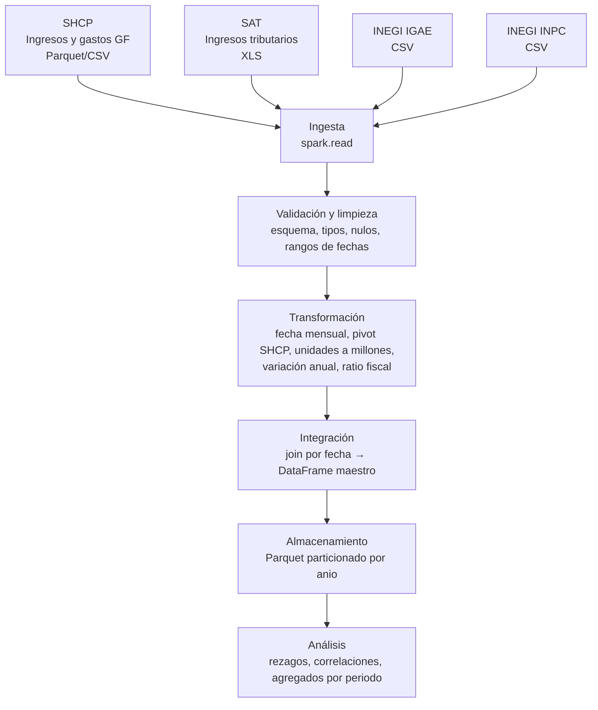

# Arquitectura inicial del pipeline

## Diagrama del flujo de datos

## Operaciones PySpark por etapa

| Etapa | Operaciones | Notas |
| :--- | :--- | :--- |
| Ingesta | `spark.read.csv(header=True)`, `spark.read.parquet` | El `.xls` del SAT se convierte primero a CSV con pandas, porque Spark no lee Excel de forma nativa. |
| Validación | `printSchema`, `count`, `filter(col.isNull())`, `agg(min, max)` sobre la fecha | Se verifica que no falten meses y que no haya duplicados por fecha (`groupBy(fecha).count() > 1`). |
| Limpieza | `cast("double")`, `to_date`, `dropna`, `filter` | Se quitan las filas de notas al pie del SAT y los meses en texto se mapean a número. |
| Transformación | `groupBy(fecha).pivot("CLAVE_DE_CONCEPTO")`, `withColumn`, `Window.orderBy(fecha)` + `lag(12)` | SHCP está en miles de pesos y SAT en millones, así que se homologan a millones. |
| Integración | `join(on="fecha", how="inner")` | Son tablas pequeñas (unos 200 meses), por lo que conviene `broadcast()` para evitar shuffle. |
| Almacenamiento | `write.mode("overwrite").partitionBy("anio").parquet(...)` | Los datos y las salidas no se versionan (ver `.gitignore`). |
| Análisis | `stat.corr`, `lag(k)` con k = 1, 3, 6, 12, `groupBy(periodo).agg(avg)`, Spark SQL | Periodos: prepandemia, pandemia y pospandemia. |

## Relación entre fuentes
- **Llave:** `fecha` = primer día del mes (`date`). Todas las fuentes son mensuales.
- **Ventana común:** 2011-01 a 2025-03 (171 meses). El análisis se restringe a 2015-01 – 2025-03, porque el IGAE de datos abiertos termina en 2025-03.
- **Riesgos:** las series son estacionales (el IGAE en niveles y la recaudación de abril con la declaración anual), por lo que se usan variaciones anuales. El INPC tiene base 2Q jul 2018 = 100 y se usa como índice. Las cifras más recientes del SAT son preliminares.
